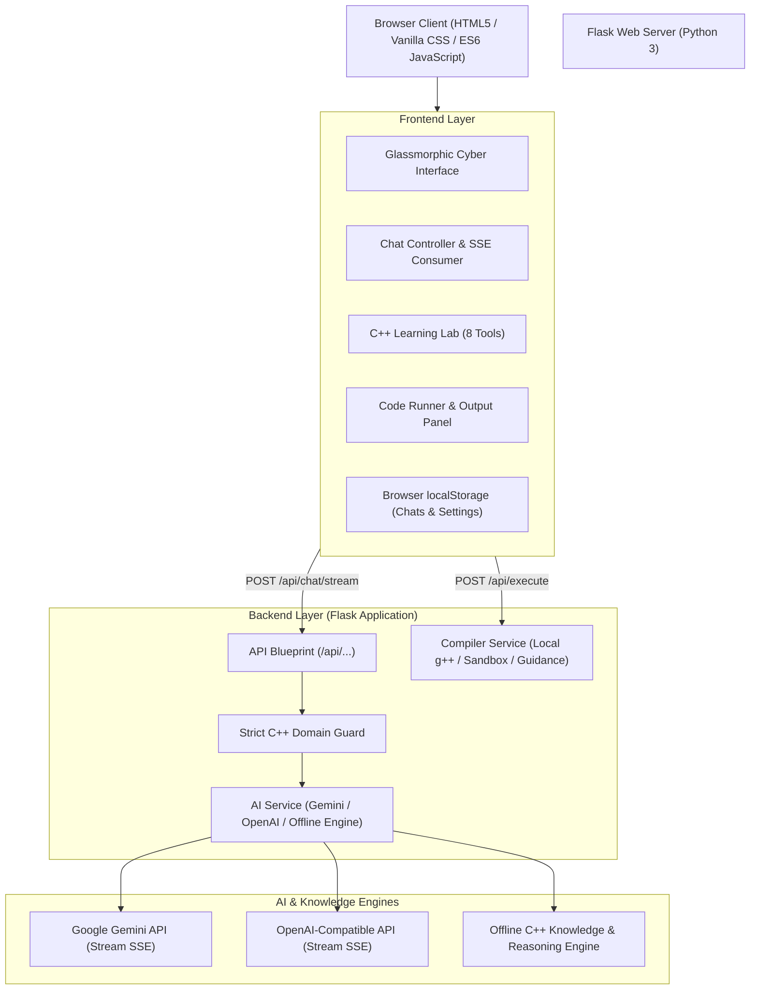

# CodeVerse AI — "Explore C++. Think Like a Programmer."

> **An Intelligent AI Programming Tutor & Coding Laboratory Built Exclusively for C++**  
> *Suitable for Computer Engineering College Exhibition, Practical Labs, and Live Technical Demonstrations.*

---

## 📌 1. Project Title & Abstract

### Title
**CodeVerse AI — An Exclusive C++ AI Chatbot and Developer Learning Laboratory**

### Abstract
Modern AI chatbots are often too generic, generating solutions across dozens of programming languages without deep consideration for low-level memory mechanics, zero-cost abstractions, compiler optimizations, or the strict rigor required in computer systems engineering. **CodeVerse AI** solves this by establishing a dedicated, domain-restricted AI programming mentor focused **exclusively on C++**. 

Built with a futuristic midnight-navy cyberpunk aesthetic, CodeVerse AI assists students and developers with ISO C++ (from C++98 up to C++23), object-oriented programming, data structures, pointer mechanics, modern RAII idioms, algorithm analysis, code output prediction, and live viva preparation. It features a sandboxed execution architecture, genuine compiler diagnostic reporting, real-time token streaming via Server-Sent Events (SSE), and a suite of 8 specialized \C++ learning lab tools.

---

## 🎯 2. Problem Statement & Objectives

### Problem Statement
Computer Engineering students frequently struggle with C++ due to:
1. Complex pointer arithmetic and manual memory management (`new`/`delete`, memory leaks, segmentation faults).
2. The nuances of Object-Oriented Programming (virtual functions, vtables, diamond inheritance problem).
3. The steep learning curve of the Standard Template Library (STL) and Modern C++ features (C++11/14/17/20/23 smart pointers, move semantics).
4. Generic AI models deviating from standard-compliant, safe C++ patterns or confusing concepts with Java/Python syntax.

### Key Objectives
* **Domain Exclusivity:** Ensure 100% adherence to C++ topics. Any out-of-scope query (sports, politics, non-C++ languages) is politely refused and redirected.
* **Pedagogical Answer Structure:** Format explanations into 7 clear learning sections: Definition, Beginner-friendly explanation, Compilable modern C++, Expected output, Step-by-step breakdown, Common pitfalls, and Practice challenge.
* **Genuine C++ Sandboxing:** Implement a real C++ compiler execution endpoint that runs genuine GCC/Clang compilers with timeouts and memory protection, never fabricating compiler outputs.
* **Interactive C++ Learning Lab:** Provide built-in tools including Concept Explorer, Code Generator, Debugging Assistant, Output Predictor, Quiz Mode, Daily Coding Challenge, STL Cheat Sheet, and Viva Examination Preparation.
* **Offline-First Resilience:** Provide an intelligent offline C++ knowledge engine capable of functioning immediately without requiring paid API keys, while smoothly upgrading to live Gemini or OpenAI models when configured.

---

## 💻 3. Software & Hardware Requirements

### Software Requirements
* **Operating System:** Windows 10/11, Ubuntu 20.04+, or macOS
* **Python Environment:** Python 3.9+ (Python 3.13 supported)
* **Backend Framework:** Flask 3.0+
* **Dependencies:** `python-dotenv`, `requests`
* **Web Browser:** Google Chrome, Microsoft Edge, Firefox, or Safari (Modern ES6+ with CSS Grid & Backdrop Filter support)
* **Optional C++ Compiler:** MinGW-w64 (`g++`), LLVM (`clang++`), or MSVC (`cl.exe`) for local code compilation

### Hardware Requirements
* **Processor:** 1.6 GHz dual-core or faster (Intel/AMD/Apple Silicon)
* **Memory (RAM):** 2 GB minimum (4 GB recommended)
* **Disk Space:** ~100 MB free space

---

## 🏛️ 4. System Architecture



---

## ⚡ 5. Frontend & Backend Workflow

1. **User Query Input:** The user enters a question into the auto-resizing composer or clicks a quick prompt chip.
2. **Client Dispatch:** The client dispatches a `POST` request to `/api/chat/stream` with the conversation history.
3. **Domain Validation:** The server-side Prompt Guard inspects the query. If an out-of-scope topic is detected, the standardized polite refusal is immediately returned.
4. **Token Streaming:** If live API keys are provided (`GEMINI_API_KEY` or `OPENAI_API_KEY`), the server streams token chunks via Server-Sent Events (SSE). Otherwise, the intelligent offline C++ knowledge engine streams educational responses.
5. **Markdown & Code Enhancement:** The frontend renders incoming markdown, applies Prism.js syntax highlighting, and transforms code blocks into interactive panels with Copy, Download, Collapse, and Run Code buttons.
6. **Code Compilation:** When the user clicks "Run Code", the backend tests for a genuine local compiler (`g++`/`clang++`). If configured, it compiles and runs in an isolated temporary directory; if not configured, it outputs the required diagnostic guidance explaining how to set up the compiler.

---

## 🛠️ 6. Installation & Local Setup

### Step 1: Clone or Navigate to the Workspace
```bash
cd e:\chatboatc++
```

### Step 2: Install Python Dependencies
```bash
pip install -r requirements.txt
```

### Step 3: Configure Environment Variables
Copy `.env.example` to `.env`:
```bash
copy .env.example .env
```

Open `.env` in any text editor and optionally add your AI API key:
```env
PORT=5000
DEBUG=True

# Optional: Add Google Gemini API Key from https://aistudio.google.com/
GEMINI_API_KEY=your_gemini_api_key_here
GEMINI_MODEL=gemini-1.5-flash

# Optional: Add OpenAI or Groq API Key
OPENAI_API_KEY=
OPENAI_MODEL=gpt-4o-mini
```
*(Note: If no API key is configured, CodeVerse AI automatically activates its Smart Offline C++ Knowledge Engine with zero setup!)*

### Step 4: Run the Application Server
```bash
python app.py
```

### Step 5: Open in Web Browser
Open your browser and navigate to:
```
http://127.0.0.1:5000
```

---

## 🧪 7. C++ Compiler Setup (Optional for Run Code)

To enable genuine C++ compilation directly on your computer:
1. **Windows:** Install **MinGW-w64** or **MSYS2**. Add `C:\msys64\mingw64\bin` to your system `PATH`.
2. **Verify:** Open a terminal and run `g++ --version`.
3. **Restart:** Restart the Flask server. CodeVerse AI will auto-detect `g++` and execute C++ programs in a sandboxed temporary directory with timeout protection.
4. If no compiler is installed, the UI displays clear instructions without fabricating output.

---

## 🎓 8. College Project Demonstration Guide

### Demonstration Steps:
1. **Welcome Screen:** Present the glowing C++ emblem, dark midnight cyber aesthetic, floating C++ tokens, and background matrix.
2. **Click Suggestion Card:** Click **"Learn C++"** or **"Explain pointers with memory diagram"**. Show the streaming response, the 7-part pedagogical breakdown, and the modern C++ code block.
3. **Run Code Button:** Click the **"Run Code"** button on the code block to show the execution panel and compiler diagnostics.
4. **Copy & Download:** Click **"Copy"** and **"Download"** to demonstrate downloading `solution.cpp`.
5. **Strict C++ Test (Out-of-Scope Guard):** Ask: *"Who won the cricket match yesterday?"* or *"Give me a chocolate cake recipe."* Watch CodeVerse AI politely refuse and redirect to C++.
6. **Open C++ Learning Lab:** Click **"Learning Lab"** in the top bar. Showcase:
   * **Concept Explorer:** Filter by Beginner, Intermediate, and Advanced.
   * **Quiz Mode:** Answer interactive C++ MCQs with instant score tracking and explanations.
   * **Viva Preparation:** Expand college practical viva questions Q1–Q8 with model answers.
   * **C++ Cheat Sheet:** Review STL container complexity comparisons and modern keywords.
7. **Local Persistence:** Refresh the browser page to demonstrate that chat conversations remain intact via `localStorage`.

---

## 📚 9. Frequently Asked College Viva Questions & Answers

### Q1. What is the difference between C and C++?
**Answer:** C is a procedural language developed by Dennis Ritchie, focusing on functions and structured steps. C++ is a multi-paradigm language created by Bjarne Stroustrup that introduces Object-Oriented Programming (classes, encapsulation, inheritance, polymorphism), generic programming (templates), exception handling, and the Standard Template Library (STL).

### Q2. What is the difference between a pointer and a reference in C++?
**Answer:**
1. A pointer stores the memory address of another variable and can be reassigned; a reference is an alias to an existing variable and cannot be rebound after initialization.
2. Pointers can be `nullptr`; references must always refer to a valid object.
3. Pointers require dereferencing (`*` or `->`); references use standard variable syntax.

### Q3. What is a virtual function and why is it used?
**Answer:** A virtual function is a base class member function declared with the `virtual` keyword that can be overridden by derived classes. It enables **runtime polymorphism (dynamic dispatch)**. When called through a base class pointer or reference, the program uses the virtual method table (vtable) to execute the derived class's implementation.

### Q4. What is the Diamond Problem and how is it resolved?
**Answer:** The Diamond Problem occurs in multiple inheritance when a class inherits from two classes that both inherit from a common base class, resulting in duplicate base class instances and ambiguous member access. In C++, this is solved using **virtual inheritance** (`class B : virtual public A`).

### Q5. What are Smart Pointers in Modern C++?
**Answer:** Introduced in C++11 under `<memory>`, smart pointers automate memory management using RAII:
* `std::unique_ptr`: Exclusive ownership of an object (non-copyable, movable).
* `std::shared_ptr`: Shared ownership using reference counting.
* `std::weak_ptr`: Non-owning observer that prevents cyclic reference memory leaks between `shared_ptr` instances.

---

## 🔮 10. Limitations & Future Scope

### Current Limitations
* Heavy CPU-bound multi-file compilation projects are limited to single-file programs in the web interface.
* Interactive stdin inputs (e.g. interactive `std::cin` prompts) currently execute non-interactively with predefined stdin text.

### Future Scope
* WebAssembly (Wasm) in-browser Clang compilation for zero-server compilation.
* Multi-file project workspace support (`main.cpp`, `header.h`, `impl.cpp`).
* Real-time memory allocation visualizer diagramming heap, stack, and pointer addresses dynamically.
